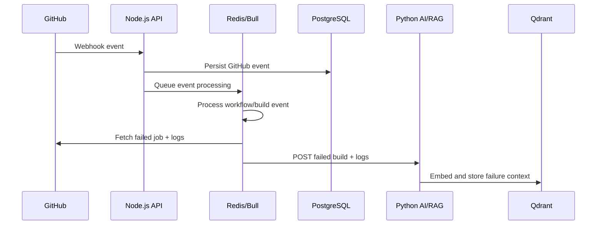
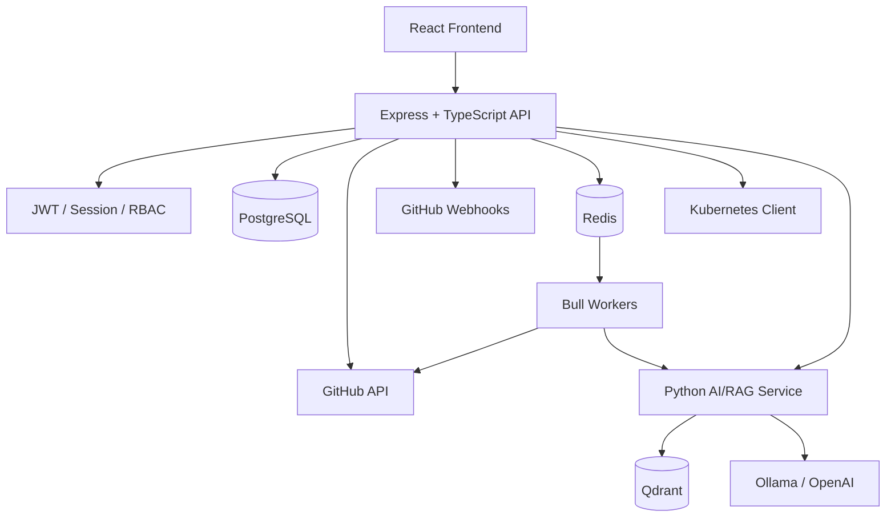

# AI DevOps Copilot — Node.js Backend

The Node.js backend is the **core application and orchestration layer** of AI DevOps Copilot. It sits between the React operations console and the external systems that contain engineering and infrastructure data: GitHub/GitHub Actions, PostgreSQL, Redis, Kubernetes clusters, and the Python AI/RAG service.

Its job is deliberately broader than serving REST endpoints. It owns authentication, application persistence, GitHub event ingestion, asynchronous processing, Kubernetes access, AI workflow orchestration, repository/build analytics, and the data contracts consumed by the frontend and Python service.

## What this service does

### 1. Authentication and authorization

The service provides:

- user signup/login/logout
- access-token and refresh-token handling
- session persistence
- JWT-based authentication
- admin authorization middleware
- password hashing with bcrypt plus application-level peppering
- encrypted token payload handling

Protected routes use the `authenticator` middleware, with `isAdmin` applied to administrative/platform-management operations.

### 2. GitHub integration

The backend integrates with GitHub for repository and CI/CD data. It can:

- connect a GitHub account
- securely persist the associated GitHub access token in encrypted form
- discover repositories and organizations
- register repositories with the platform
- retrieve workflow/build information
- fetch repository/build details for the AI service
- create repository and organization webhooks
- ingest GitHub webhook events
- react to failed GitHub Actions workflow runs

The webhook configuration listens to events including workflow runs, workflow jobs, pushes, pull requests, issues, issue comments, membership, and repository events.

### 3. Event-driven failed-build processing

A key architectural feature is asynchronous failure processing.



This separates webhook acknowledgement from potentially expensive downstream processing. Bull is backed by Redis and is used for webhook creation, webhook event processing, organization webhook creation, and failed-build processing.

### 4. Kubernetes integration

The backend uses `@kubernetes/client-node` and a dedicated cluster connection service to connect to registered clusters.

Supported cluster provider values in the current data model include:

- `LOCAL`
- `AWS_EC2_K3S`
- `AWS_EKS`
- `AZURE_AKS`
- `GCP_GKS`

Supported authentication records include:

- `KUBECONFIG`
- `AWS_IAM`
- `SERVICE_ACCOUNT`
- `OIDC`

The Kubernetes service exposes APIs for:

- cluster registration and discovery
- dashboard-level cluster health
- namespaces
- pods
- deployments
- services
- nodes
- jobs
- replica sets
- stateful sets
- daemon sets
- cron jobs
- ingress
- config maps
- secrets
- persistent volumes
- resource-specific details
- Kubernetes events
- pod usage/metrics

### 5. AI orchestration

The Node backend is the controlled gateway between the user-facing assistant and the Python AI service.

For chat requests it:

1. creates a conversation/message record;
2. creates an AI-run record;
3. forwards the user message and authenticated token to Python;
4. receives the AI response plus operational metadata;
5. persists the assistant response;
6. updates AI-run status, latency, token counts, model, and provider information.

The backend also exposes a dedicated AI data endpoint that allows the Python service to request authoritative build/repository data rather than querying the database directly.

## Architecture



## Request and event flows

### User request flow

```text
React Frontend
      ↓
Express route
      ↓
Authentication middleware
      ↓
Controller
      ↓
Service / PostgreSQL / GitHub / Kubernetes / Python
      ↓
Normalized API response
      ↓
React Frontend
```

### GitHub webhook flow

```text
GitHub
  ↓
/api/webhook/wb or /api/webhook/org
  ↓
Signature verification
  ↓
Queue via Redis/Bull
  ↓
Persist GitHub event
  ↓
Detect failed workflow run
  ↓
Fetch failed jobs + logs from GitHub
  ↓
Send failure payload to Python /rag/ingest-build-failure
```

## API surface

The service is organized into route groups:

| Route group | Responsibility |
|---|---|
| `/api/users` | Authentication, profile, sessions, user administration |
| `/api/actions` | GitHub accounts, repositories, pipelines, build information, dashboard analytics |
| `/api/chats` | Conversation creation, message history, AI chat execution |
| `/api/ai` | AI-facing workflow/build data |
| `/api/kubernetes` | Cluster registration, discovery, resources, events, usage, provider/environment data |
| `/api/webhook` | GitHub repository and organization webhooks |
| `/api/metrics` | Service metrics/check endpoint |
| `/api/index` | Health endpoint |

### Representative endpoints

```text
POST /api/users/v1/login
POST /api/users/v1/logout
POST /api/users/v1/refresh
GET  /api/users/v1/profile

GET  /api/actions/v1/pipeline
GET  /api/actions/v1/info/build
GET  /api/actions/v1/info/main
GET  /api/actions/v1/build/chart
GET  /api/actions/v1/agent/usage
GET  /api/actions/v1/success/rate
GET  /api/actions/v1/dashboard/rd
GET  /api/actions/v1/dashboard/repos

POST /api/chats/v1/chat/:branch
GET  /api/chats/v1/stream/:branch
PATCH /api/chats/v1/new/message/:branch

POST /api/kubernetes/v1/register/cluster
GET  /api/kubernetes/v1/clusters
GET  /api/kubernetes/v1/dashboard/kube
GET  /api/kubernetes/v1/info/:namespace/:provider/:environment
GET  /api/kubernetes/v1/ns
GET  /api/kubernetes/v1/resources/:type
GET  /api/kubernetes/v1/resource/detail/:name/:type/:namespace
GET  /api/kubernetes/v1/events/:namespace
GET  /api/kubernetes/v1/pods/usage/:namespace

POST /api/webhook/wb
POST /api/webhook/org
```

## Persistence model

The backend uses PostgreSQL with Knex-based migrations. The current migration history includes entities for:

- users, teams, team members
- sessions
- GitHub accounts
- repositories
- repository webhooks
- organization webhooks
- GitHub events
- services/resources
- conversations/messages
- AI runs/tool calls
- clusters
- cluster credentials
- cluster users

This makes PostgreSQL the system-of-record for application state, while Redis is used for asynchronous/background processing and Qdrant is used by the Python service for vector retrieval.

## Security controls implemented in the codebase

The backend includes several security-oriented mechanisms:

- JWT-based access/refresh authentication
- authenticated and admin-only route middleware
- password hashing using bcrypt with peppering
- encrypted GitHub access-token storage
- GitHub webhook signature verification using HMAC SHA-256 and timing-safe comparison
- Helmet security middleware
- credentialed CORS configuration
- parameterized database access through the database abstraction layer
- environment-based secret/configuration loading

Production deployments should still review cookie flags, CORS origins, secret-management strategy, network policies, and least-privilege permissions for the specific deployment environment.

## Key implementation areas

```text
src/
├── controllers/             # Request-level application logic
├── routes/                  # REST route definitions and middleware composition
├── middlewares/             # Authentication, admin authorization, error handling
├── services/                # Kubernetes and cluster connection abstractions
├── models/pg/               # PostgreSQL queries/data access
├── models/redis/            # Redis connection + Bull queue workers
├── migrations/              # Database schema history
├── helper/                  # Configuration, crypto, general helpers
├── utils/                   # API response/types/interfaces/enums
└── liver/                   # HTTP server bootstrap
```

## Configuration

The backend reads required configuration from environment variables. Important groups include:

### Authentication and encryption

```text
ACCESS_TOKEN_SECRET
JWT_SECRET
ACCESS_TOKEN_EXPIRES_IN
JWT_EXPIRES_IN
ENCRYPTION_ALGO
ENCRYPTION_IV
ENCRYPTION_SECRET
PEPPER
SALT_ROUNDS
```

### GitHub

```text
GITHUB_BASE_URL
GITHUB_TOKEN
GITHUB_TOKEN_ORG
GITHUB_WEBHOOK_SECRET
GITHUB_ENCRYPTION_KEY
GITHUB_ENCRYPTION_KEY_LENGTH
GITHUB_ENCRYPTION_ALGO
WEBHOOK_HOST
```

### Internal services and queues

```text
PYTHON_MSRV
REDIS_HOST
REDIS_PORT
REDIS_PASSWORD
```

### AI provider/runtime checks

The repository also contains provider/model availability checks using configuration such as:

```text
LLM_PROVIDER
LLM_MODEL
OLLAMA_HOST
OLLAMA_BASE_URL
OLLAMA_MODEL
OLLAMA_NAMESPACE
OLLAMA_POD_NAME
OPENAI_API_KEY
OPENAI_BASE_URL
```

### Runtime

```text
NODE_ENV
PORT
AI_DEVOPS_RUNTIME_CLUSTER_ID
KUBERNETES_SERVICE_HOST
```

Never commit real secrets, GitHub tokens, JWT secrets, encryption keys, database credentials, or provider API keys to the repository.

## Running the backend

The source archive supplied for this review contains the TypeScript application and migration source but does not include the repository dependency manifest/configuration files. For that reason, this README intentionally does not invent package versions or package-manager commands.

Use the scripts defined by the actual repository's `package.json` and its database/Knex configuration when installing dependencies, starting the server, and running migrations.

For a working deployment, the following services must be available and correctly configured:

- PostgreSQL
- Redis
- GitHub API access
- Python AI/RAG service
- Kubernetes API access for registered clusters

## Why the backend is designed this way

The architecture separates synchronous API traffic from asynchronous operational processing. GitHub webhook requests can be acknowledged quickly while Redis/Bull handles downstream work such as webhook creation, event persistence, failed-job log retrieval, and RAG ingestion.

The service also centralizes access to GitHub, Kubernetes, and application data. That gives the frontend and Python AI service a consistent application-level contract without giving either client direct access to internal database connections or Kubernetes client logic.

## Related services

This repository is one of three main runtime components:

- **AI DevOps Frontend** — React operations console and AI assistant UI.
- **AI DevOps Node.js Backend** — API, authentication, persistence, integrations, queues, and orchestration.
- **AI DevOps Python Microservice** — AI agent, live-tool execution, embeddings, RAG retrieval, and LLM providers.
